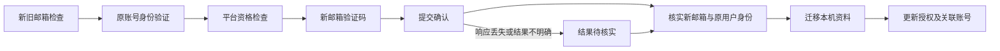

# 换绑邮箱功能调研

调研日期：2026-10-22。依据公开资料与本仓库代码分析，未发起实际账号换绑。后续已接入单账号实现，当前测试使用本地模拟服务，尚未验证线上接口兼容性。

**当前实现与账号资格**

- 操作列提供单账号“换绑邮箱”，支持手动验证码、可选新邮箱 GET 收码地址；不提供批量换绑。
- Plus、Team、Team 5x、5x、20x 等套餐或标记不作为换绑资格依据。取得原账号登录身份后立即查询资格，只有明确允许才准备新邮箱收码并发送验证码；不允许、缺失字段、非布尔值或请求失败均提前停止。
- 官方帮助页本次返回 HTTP 403，因此未确认登录方式、企业域、SSO、次数或冷却期的完整限制。不能把未经核实的规则硬编码为账号类型黑名单。
- 保留原 2FA，核对原用户与新邮箱登录身份后迁移本地记录；提交结果不明时只核实，不自动重发。恢复不会自动启动平台操作。
- 可选更新已关联 Sub2API 账号，沿用原远端 ID；多个同邮箱关联会在新邮箱发码前停止。授权、保存或同步未完成时单独显示后续操作。

有可参考的开源实现，可以规划接入。主要工作包括平台身份验证、新邮箱验证、本地凭据迁移和授权文件更新。当前依据是第三方代码，尚不能承诺这批 Plus / Team 5x 账号全部支持换绑。

**来源及证据强度**

| 来源 | 已核实内容 | 仍不能据此确认的内容 |
| --- | --- | --- |
| [gpt-bindflow，2026-08-25 提交](https://github.com/maile456/gpt-bindflow/commit/a3a3e9c4831a47853db4c3ee9dc5bc74e4651bf0) | 包含登录、新邮箱收码、换绑和结果导出的完整代码 | 当前线上接口兼容性、每种账号的换绑资格 |
| [换绑流程源码](https://github.com/maile456/gpt-bindflow/blob/a3a3e9c4831a47853db4c3ee9dc5bc74e4651bf0/tools/account_pipeline.py#L273-L442) | 先检查资格，再发起新邮箱验证，提交新邮箱验证码后检查成功标记；未看到独立的第四个“提交换绑”步骤 | 验证成功响应后，当前会话是否立即更新邮箱、是否影响其他会话 |
| [登录与任务组织代码](https://github.com/maile456/gpt-bindflow/blob/a3a3e9c4831a47853db4c3ee9dc5bc74e4651bf0/backend_runtime/pipeline_ops.py)及 [README](https://github.com/maile456/gpt-bindflow/blob/a3a3e9c4831a47853db4c3ee9dc5bc74e4651bf0/README.md) | 原账号使用密码和 TOTP 登录；按平台需要读取原邮箱验证码，新邮箱取码地址单独配置 | 原邮箱验证码并非所有账号都会需要；不能承诺只靠密码就一定能继续 |
| [参考项目测试](https://github.com/maile456/gpt-bindflow/blob/a3a3e9c4831a47853db4c3ee9dc5bc74e4651bf0/tests/test_standalone.py#L185-L220) | 本次看到的成功流程测试使用登录和换绑替身 | 模拟成功不能证明真实账号可用 |
| [官方帮助页入口](https://help.openai.com/en/articles/4936827-how-to-change-your-email-address) | 本次直接访问返回 HTTP 403，未取得正文 | 支持哪些登录方式、企业账号限制、次数限制及订阅影响均须另行核实 |

参考项目读取 MFA 状态，但没有把关闭原 2FA 作为换绑前置步骤。设计上应保留现有 2FA，按平台要求完成身份验证；若平台不允许某类账号换绑，显示具体限制并停止。

**建议的用户流程**

1. 选择原账号，填写新邮箱，以及新邮箱的收码配置；也可以选择手动输入验证码。
2. 检查新旧邮箱不同、目标地址未被本机其他任务占用、当前账号没有未完成的安全操作。
3. 暂停该账号的自动重登，使用原账号资料重新验证身份，记录服务端用户标识和原工作区。
4. 检查平台是否允许换绑。不符合条件、目标邮箱已占用、需要额外验证或接口不兼容时，明确显示原因。
5. 发起新邮箱验证，只接收该邮箱、本次操作的新验证码。原邮箱的登录验证码与新邮箱的换绑验证码分开处理。
6. 提交确认后核实新邮箱身份，确认仍为同一用户，并检查原工作区与套餐记录。
7. 持久保存确认结果，迁移本机资料，以新邮箱重新获取 Codex OAuth；如有已关联的 Sub2API 账号，再按原远端账号 ID 更新。

提交确认的请求可能已经改变平台状态。响应丢失后进入“结果待核实”，先查询或重新验证身份，不盲目重发，也不将其描述为“取消成功、原邮箱未变”。

**需要提供的资料**

| 信息 | 用途 |
| --- | --- |
| 当前账号及其可用登录资料 | 验证原账号；按平台要求使用密码、原 2FA 或原邮箱验证码 |
| 新邮箱 | 目标登录地址，能否使用由平台最终检查 |
| 新邮箱收码方式 | 手动输入验证码，或提供收码 API；POST 收码还需相应请求体及请求头 |
| 明确的新旧邮箱配对 | 单账号弹窗展示原邮箱，目标地址必须与原地址不同且未被占用 |

原账号密码和 2FA 从本机已有资料读取；登录仍可能按平台要求需要手动验证码。新收码地址可省略。当前自动收码只接入 GET，请求头或 POST 等复杂收码配置使用手动输入。

**本仓库必须同步改造的部分**

| 位置 | 当前行为 | 换绑所需改造 |
| --- | --- | --- |
| `src/protocol-login.mjs` | 登录及身份校验以输入邮箱为准；导出凭据携带邮箱 | 验证原账号后允许邮箱发生预期变化，核对稳定用户身份；重新生成带新邮箱的授权文件 |
| `src/console-server.mjs` 的 `findJobByEmail`、`withEmailJobLock` | 去重和互斥按邮箱进行 | 对原邮箱、目标邮箱建立操作预留；仍保留任务 UUID，不创建第二个账号覆盖原任务 |
| `src/credential-store.mjs` | Linux 以邮箱作为键；macOS / Windows 的存储位置也由邮箱派生 | 先保存新邮箱键下的凭据，确认任务资料迁移成功后再清理旧键；保存失败应可恢复 |
| `job-meta.json` 与账号标记 | 保存邮箱、分组、标签、备注和操作状态 | 更新当前邮箱，保留 UUID、创建时间、标记及历史邮箱记录 |
| `src/mail-otp.mjs` 及控制台收码逻辑 | 登录阶段读取当前任务的邮箱配置 | 分别维护原邮箱和新邮箱的收码配置，按阶段选择；不通过改全局配置来切换单个账号 |
| 登录检查点与操作结果 | 多个结果文件会校验邮箱一致性 | 新换绑记录以任务 UUID 和操作编号关联；旧邮箱检查点不得继续冒充新邮箱会话 |
| OAuth 导出 | 邮箱同时存在于普通字段及签名令牌的声明中 | 重新授权后更新；不能只替换 JSON 中的邮箱字符串就声称授权已更新 |
| Sub2API 巡检 | 先按邮箱匹配本地任务，再按远端账号 ID 更新 | 换绑前记录已有远端关联；之后沿用原远端 ID 更新，避免新旧邮箱各产生一条账号 |
| `web/src/main.jsx` 与状态筛选 | 当前没有换绑表单及新邮箱验证阶段 | 增加单账号入口、配对预览、待新邮箱验证码、待核实、本地迁移待完成和授权待更新状态 |

本地目录已经使用任务 UUID，因此不需要把目录改名为新邮箱。互斥锁应只包住短暂的检查和状态写入；等待用户验证码时持有整个邮箱锁，会阻塞取消和验证码输入，应改为持久预留加短锁。

当前导出函数把 `claims.sid` 写入 `chatgpt_account_id`。实施前需要核实该值的实际语义，不能未经验证就将它作为永久用户标识；身份连续性核对应结合服务端用户 ID 和工作区信息。

**保存和恢复策略**

- 平台尚未确认换绑成功：当前邮箱和原凭据继续保留，新邮箱仅作为本次操作的目标。
- 平台已确认、本地保存未完成：优先保存确认记录；重启只重试本地迁移，不再次发送平台换绑请求。
- 新邮箱键下凭据保存失败：保留旧存储条目与操作记录，显示“平台已换绑，本地资料待恢复”，不能报成原邮箱仍有效。
- 本地迁移完成、OAuth 获取失败：显示“邮箱已换绑，授权待更新”，原授权文件不得被伪装为新授权。
- Sub2API 同步失败：记录待同步的远端账号 ID，保留本地换绑成功结果；重试远端同步时不重复换绑。
- 恢复完成后，按换绑前的设置决定是否恢复自动重登；不擅自解除用户此前手动设置的暂停。

参考项目的未完成任务主要保存在内存，且最终验证码提交也包含网络重试循环。接入本项目时应增加持久操作记录，并收紧最终提交的重试行为；不能直接搬用它的恢复策略。

**验证和实施顺序**

1. 先完成一个账号的正常链路：原账号登录、新邮箱验证码、平台确认、身份核对、本地迁移及重新授权。
2. 核对这批 Team 5x 账号的资格、换绑后的工作区与套餐记录。不能仅凭套餐名称推断全部账号可换。
3. 验证目标邮箱占用、验证码错误或过期、旧邮件误匹配、额外身份验证、限流、404/405 等失败场景。
4. 在提交前、提交后响应丢失、本地保存中断、重启、OAuth 失败和 Sub2API 同步失败等位置验证恢复行为。
5. 按单账号需求接入列表入口，每个账号独立记录结果，同一目标邮箱只能被一个操作预留。

目前提供单账号换绑、手动验证码及可选 GET 收码；测试使用模拟资格、验证码和身份响应，只能验证本地流程，不能证明所有真实账号或当前线上接口都支持换绑。真实账号的现行资格和流程仍须以平台结果为准。
